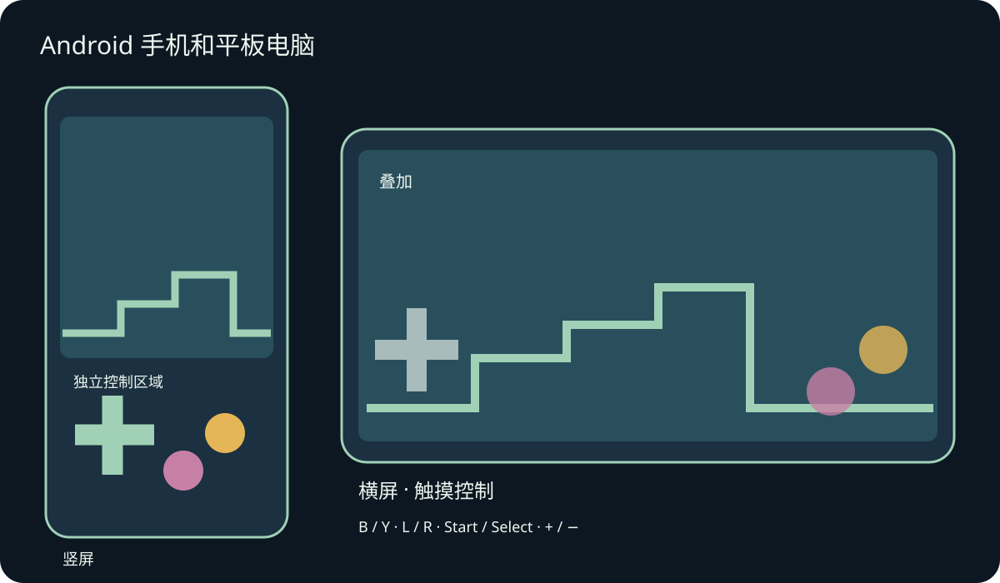
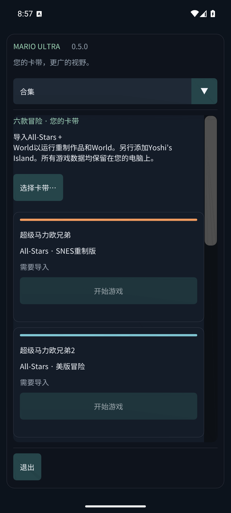

# Mario Compilation Ultra 0.5.0 · Android 手机和平板电脑

[English](../en/MOBILE.md) · [Français](../fr/MOBILE.md) · [Español](../es/MOBILE.md) · [日本語](../ja/MOBILE.md) · [Deutsch](../de/MOBILE.md) · [Italiano](../it/MOBILE.md) · [Português](../pt/MOBILE.md) · [Русский](../ru/MOBILE.md) · [简体中文](../zh/MOBILE.md) · [한국어](../ko/MOBILE.md)

安装 Android 手机/平板 APK，然后从应用列表打开 Mario Compilation Ultra。GitHub 公开 APK 需要选择自己的卡带文件；含 ROM 的个人版本已准备好全部六款游戏。Quest APK 是独立的头显应用。需要 Android 8 或更新版本及 OpenGL ES 3，包含 ARM64、ARMv7 和 x86_64。

旋转和调整窗口大小不会重置游戏。安全边距避开屏幕缺口与系统导航区域。

使用多指同时移动、奔跑和跳跃。连接手柄后，自动触摸控件会隐藏。Android 返回键打开菜单。

按钮与 SNES 一致：多数马里奥游戏中 B 跳跃、Y 奔跑。L、R、Start 和 Select 均可用。视图按钮循环切换五种模式，减号/加号调整像素缩放。按住回退可倒放。选项立即暂停游戏。用手指滚动菜单，窄屏通过顶部列表切换页面。

- 移动屏幕方向
- 触摸控制
- 触摸布局
- 触摸按钮大小
- 触摸控件不透明度
- 左手布局
- 触摸振动
- 游戏时保持屏幕常亮

存档位、回退和卡带存档使用应用私有存储。进入后台会写入卡带存档，并在启用时保存恢复位 0。使用同一签名 APK 更新可保留进度。卸载或清除应用数据会删除本地卡带与存档。存档操作位于存档与声音页面。

手机和平板模拟器测试与实体设备测试分开记录。性能、手柄映射、屏幕缺口和厂商窗口行为可能因设备而异。macOS 构建仍为实验版，未在实体 Mac 上测试。具体覆盖范围见验证报告。

[Android APK](https://github.com/vhaloo/MarioCompilationUltra/releases/download/v0.5.0/MarioCompilationUltra-0.5.0-Android-public.apk) · [HTML](mobile.html) · [Guide](README.md) · [Quest](XR.md) · [Validation](../TEST_REPORT.md)

[Adaptive Android apps](https://developer.android.com/develop/adaptive-apps/guides/support-different-display-sizes) · [16 KiB page sizes](https://developer.android.com/guide/practices/page-sizes)
