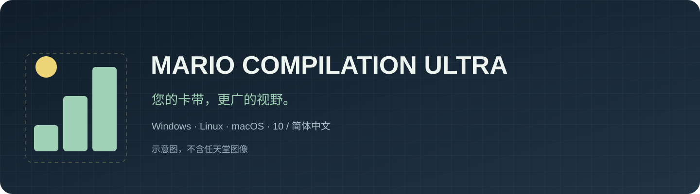
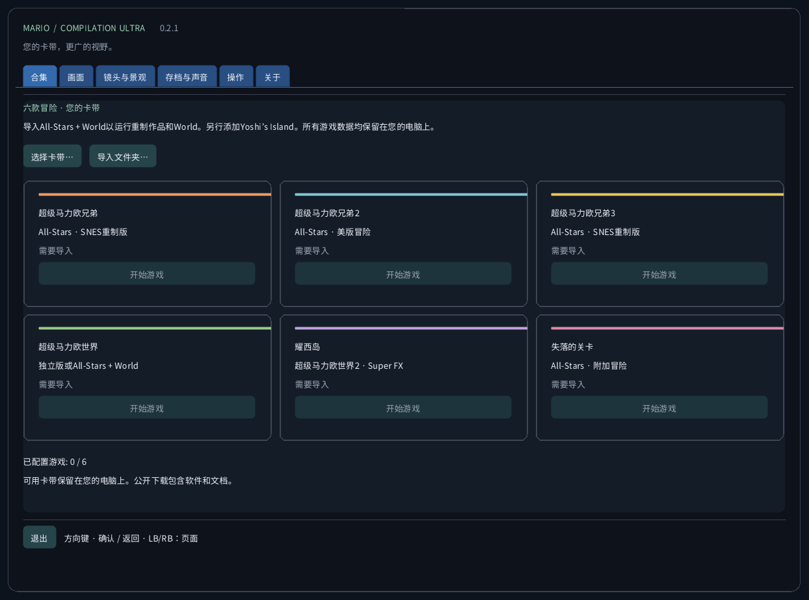
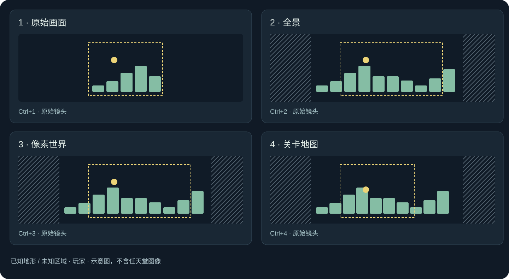
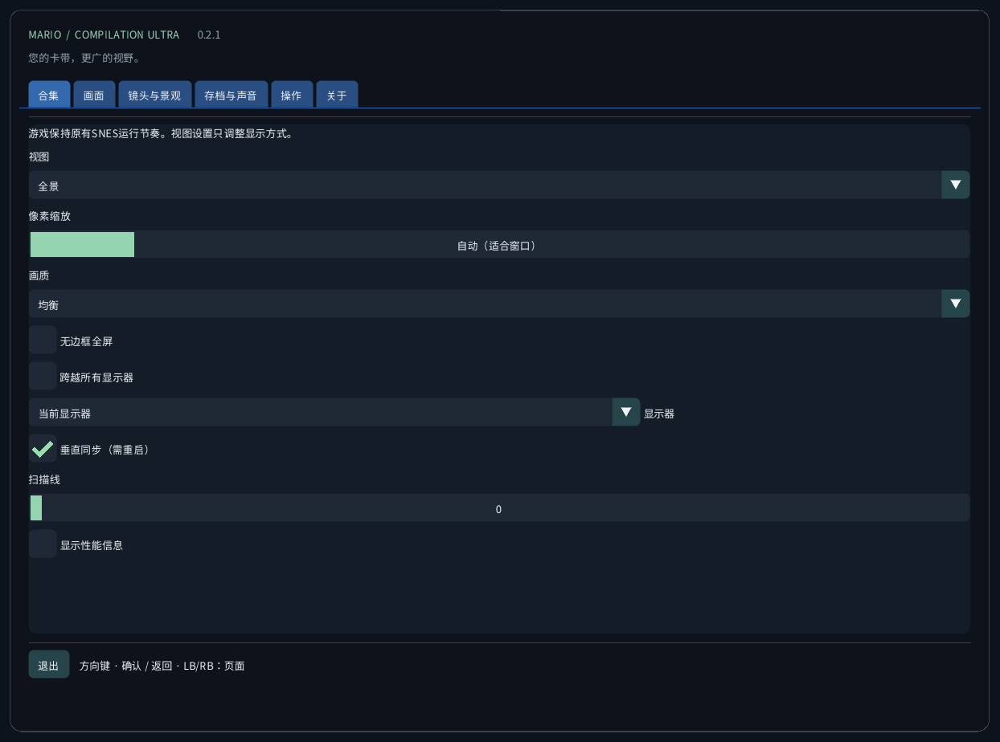
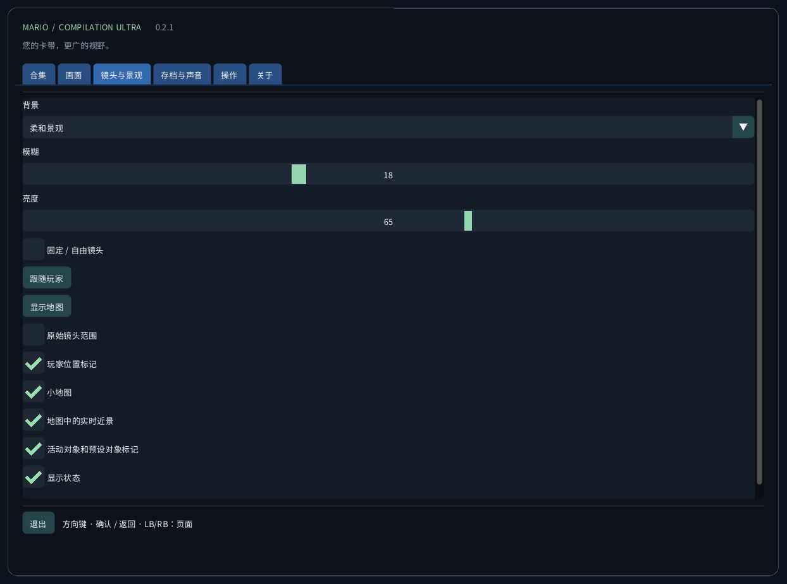
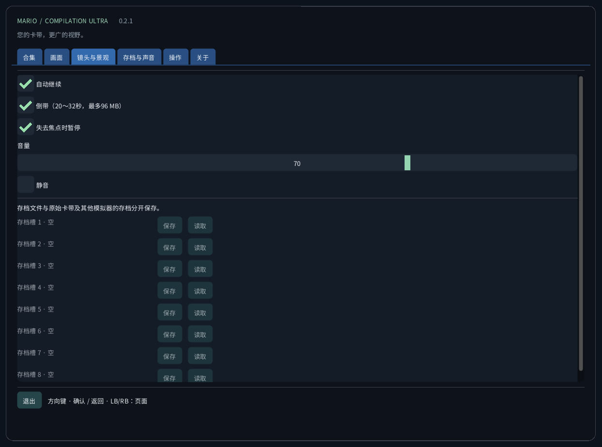
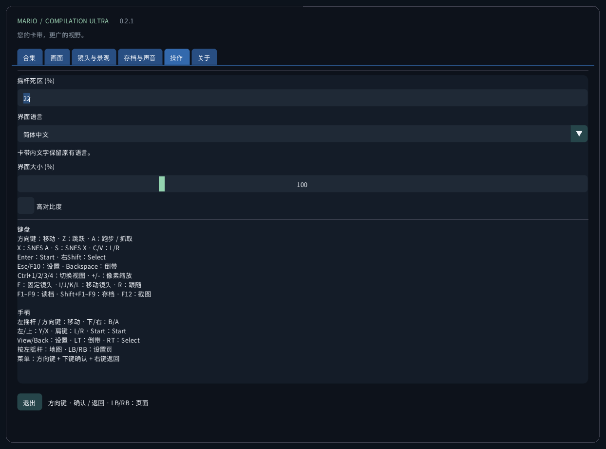
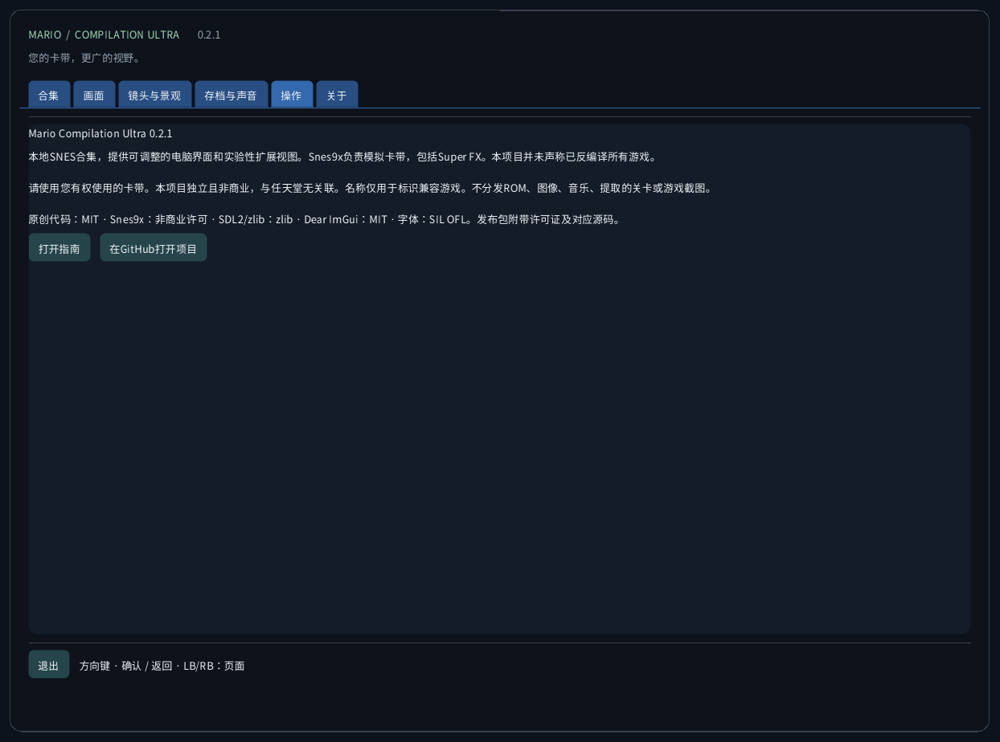

<!-- Generated by tools/guides.py; edit docs/guide-texts.json and assets/locales. -->


[English](../en/README.md) · [Français](../fr/README.md) · [Español](../es/README.md) · [日本語](../ja/README.md) · [Deutsch](../de/README.md) · [Italiano](../it/README.md) · [Português](../pt/README.md) · [Русский](../ru/README.md) · [简体中文](../zh/README.md) · [한국어](../ko/README.md)

# Mario Compilation Ultra 0.2.1

本地SNES合集，提供可调整的电脑界面和实验性扩展视图。Snes9x负责模拟卡带，包括Super FX。本项目并未声称已反编译所有游戏。

[下载与桌面启动](https://github.com/vhaloo/MarioCompilationUltra/releases/tag/v0.2.1) · [HTML](guide.html) · [GitHub](https://github.com/vhaloo/MarioCompilationUltra)

## 下载与桌面启动

1. 下载适合电脑的平台包并完整解压ZIP。请将程序、SDL、资源和指南保存在一起。Windows打开MarioCompilationUltra.exe；Linux运行Play.sh；Mac打开应用。
2. 通过选择卡带、导入文件夹或拖放，导入自己的.sfc、.smc或只含一张卡带的ZIP。文件选择器从应用的数据文件夹打开。将兼容卡带直接放入此文件夹后，下次启动会自动识别。
3. All-Stars + Super Mario World包含马里奥1、美版马里奥2、马里奥3、World和The Lost Levels。Yoshi’s Island需单独添加。选择开始游戏，再在原版标题画面按Enter或Start；若正在播放演示，请再按一次。

Windows运行Install-Windows.ps1，将完整软件包复制到用户Programs文件夹并创建桌面快捷方式。Linux运行Install-Linux.sh，将此便携文件夹注册到应用菜单和桌面。Mac将应用移至Applications并创建桌面替身。请保留所选文件夹的位置。

```powershell
# Windows
powershell -NoProfile -ExecutionPolicy Bypass -File .\Install-Windows.ps1
```

```sh
# Linux
sh ./Install-Linux.sh
```



*截图来自未加载卡带的真实应用。示意图使用原创说明图形，并非游戏美术。公开下载不含Nintendo ROM、精灵、音乐、提取关卡或游戏截图。*

## 软件包与验证

- Windows x64：已检查本机桌面启动与卡带运行，并执行自动测试。
- Linux x64：自动构建与不含ROM的检查。尚未在实体Linux桌面电脑上测试游戏。
- **macOS Intel x64与Apple Silicon arm64：实验版，未在实体Mac上测试。自动环境仅检查构建与不含ROM的界面。采用临时签名，未公证；实体设备上的手柄、声音、图形和Gatekeeper尚未验证。**

## 视图模式



默认视图为全景。在像素世界中选择自动设置，即可使用能完整显示原始画面的最大整数倍率，也可手动选择1至8倍。观测地图根据已探索的相机范围取景；World显示已加载的区域。原始相机外的装饰背景重复有效的可见区域。

World地图册显示当前加载的区域，并非一次显示游戏所有区域。马里奥1、Lost Levels、马里奥2、马里奥3和Yoshi普通场景在移动时积累已观察地形。未知区域以斜线表示。原镜头外的效果与精灵可能不同。特殊投影使用原始画面。

扩展内存配置与All-Stars自动选择针对所列美版。已识别但没有已验证配置的版本使用原始画面。界面翻译不会翻译商业卡带的剧情或图像。项目并不声称实现了全部五款游戏的新原生反编译版本。

| CRC32 | SNES |
|---|---|
| `f84305b1` | All-Stars + World (US) |
| `925637c7` | All-Stars (US) |
| `b19ed489` | Super Mario World (US) |
| `d138f224` | Yoshi’s Island 1.0 (US) |
| `cf98ddaa` | Yoshi’s Island 1.1 (US) |

## 操作

键盘<br>
方向键：移动 · Z：跳跃 · A：跑步 / 抓取<br>
X：SNES A · S：SNES X · C/V：L/R<br>
Enter：Start · 右Shift：Select<br>
Esc/F10：设置 · Backspace：倒带<br>
Ctrl+1/2/3/4：切换视图 · +/-：像素缩放<br>
F：固定镜头 · I/J/K/L：移动镜头 · R：跟随<br>
F1–F9：读档 · Shift+F1–F9：存档 · F12：截图<br>
<br>
手柄<br>
左摇杆 / 方向键：移动 · 下/右：B/A<br>
左/上：Y/X · 肩键：L/R · Start：Start<br>
View/Back：设置 · LT：倒带 · RT：Select<br>
按左摇杆：地图 · LB/RB：设置页<br>
菜单：方向键 + 下键确认 + 右键返回

## 存档与声音

每款游戏提供九个手动存档槽、自动继续、电池SRAM和有限回退。回退最多使用96 MiB，约20–32秒。F1–F9读取，Shift+F1–F9保存。存档检查卡带CRC、核心版本与完整性，并与其他模拟器存档分开。

## 本地文件

此文件夹包含settings.ini、卡带本地引用、states/、saves/和screenshots/。导入不会上传卡带或修改原文件。更换电脑前请备份此文件夹。即时存档依赖完全相同的卡带与核心；SRAM是独立文件。

| OS | 本地卡带文件夹 |
|---|---|
| Windows | `%APPDATA%/ValentinWittwe/MarioCompilationUltra/` |
| Linux | `$XDG_DATA_HOME/ValentinWittwe/MarioCompilationUltra/` or `~/.local/share/ValentinWittwe/MarioCompilationUltra/` |
| macOS | `~/Library/Application Support/ValentinWittwe/MarioCompilationUltra/` |

--data-dir可覆盖默认目录。Windows快捷方式更新会保留该选项。本地文件页面显示实际使用的文件夹。

## 若游戏仍提示需要导入

若文件已移动或磁盘断开，请重新选择卡带。ZIP必须只含一个.sfc或.smc，且采用未加密的存储或DEFLATE压缩。请核对支持的版本与卡带头。若缺少字体或SDL，请重新完整解压软件包。

## 真实界面图集

### 合集


### 画面



### 镜头与景观



### 存档与声音



### 操作



### 关于



## 软件包与验证 · 0.2.1

公开检查涵盖85项测试、十种语言的166条消息、字体覆盖和240张真实界面截图。Windows本地私密检查涵盖六款游戏、2160种显示配置、九个存档槽、自动恢复、SRAM、回退和手柄事件。这些只是有限场景，并非完整通关；未认证实体按钮操作或可听音频。详见测试报告。

[CTest / CI](https://github.com/vhaloo/MarioCompilationUltra/actions) · [Report](../TEST_REPORT.md) · [Build](../BUILD.md) · [Source / research](../RESEARCH.md)

请使用您有权使用的卡带。本项目独立且非商业，与任天堂无关联。名称仅用于标识兼容游戏。不分发ROM、图像、音乐、提取的关卡或游戏截图。

原创代码：MIT · Snes9x：非商业许可 · SDL2/zlib：zlib · Dear ImGui：MIT · 字体：SIL OFL。发布包附带许可证及对应源码。

[Licence](../../LICENSE) · [Third-party notices](../../THIRD_PARTY_NOTICES.md)
