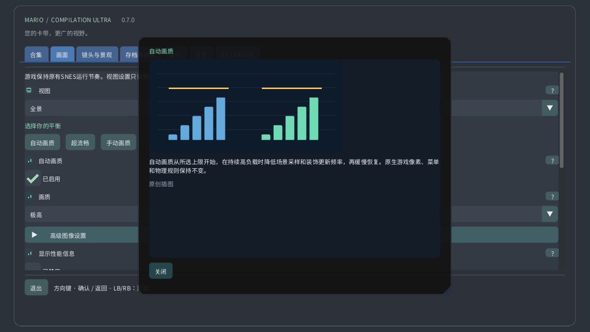

# 图解设置

## 合集

选择本地卡带，启动游戏或打开指南。公开下载不包含游戏或你的存档。

## 视图

原始视图保留主机画面，全景视图将其扩展。地图集显示可用地形；完整地图在解码器支持时读取整个已加载区域，包括未探索部分。门可能切换区域。

## 镜头与景观

选择跟随原始镜头、角色或固定位置。这只改变取景，不会移动角色，也不会激活远处敌人。

## 手表缩放

缩放决定屏幕可见范围。在手表上，0%显示整个已加载地图，100%回到原始镜头。游戏速度保持不变。

## 圆屏鱼眼

在圆形手表上，镜头将整个游戏矩形弯曲成圆形，同时保留图像边缘。按钮和文字保持平直。关闭后显示无变形矩形。

## 表冠灵敏度

检测到的表冠或旋转表圈可在游戏中控制缩放，在菜单中滚动。灵敏度决定每次旋转幅度，反转可交换方向。没有表冠也能触控缩放。

## 图像滤镜

最近邻保留硬像素边缘，清晰滤镜适合非整数缩放，平滑滤镜柔化放大图像。原始画面和碰撞规则不变。

## 画面比例

方形像素使用原始像素形状，电视4:3模拟电视画面比例。像素世界始终使用方形像素和整数缩放。

## 自动画质

自动画质从所选上限开始，在持续高负载时降低场景采样和装饰更新频率，再缓慢恢复。原生游戏像素、菜单和物理规则保持不变。

## 性能余量

性能余量为每帧保留处理意外工作的时间。余量越大越重视流畅。超流畅使用40%，Quest至少保留35%。持续有余量时画质会恢复。

## 响应设备发热

Android的本地热状态可在温度进一步升高前降低装饰细节，无需额外权限或联网。实际时钟和刷新率仍由系统控制。

## 垂直同步

垂直同步跟随显示器以减少画面撕裂。游戏保留原始时钟。Quest使用选定的头显刷新率，并据此计算性能余量。

## VR着色器

高效CRT以较少计算保留复古外观。自动模式先用高效版，仅在测得持续GPU余量后允许参考版。参考模式固定使用更昂贵的计算。

## 画面

选择窗口、显示器或全屏行为。这些选项只改变画面显示位置，不改变已加载关卡或存档。

## 背景

背景填充游戏周围的空白。柔和风景采用游戏色彩，午夜和黑色更简洁。模糊与亮度影响这个外围背景。

## 模糊

模糊柔化周围风景，亮度控制其明暗，两者都不改变原生画面。负载较高时，自动画质可能降低装饰更新频率。

## 柔化全景边缘

柔和边缘在原始镜头附近将扩展场景融入背景。关闭后接缝更清晰。完整地图保留独立取景范围。

## 玩家位置标记

定位标记指出角色，参考框表示原始镜头，小地图显示其在区域中的位置。拉远地图时，近景保留原生屏幕的可读性。

## 预览已放置敌人

预览显示已验证的位置或本地观察到的外观。淡化物体与轮廓只是提示，不是额外激活的敌人。透明度和标签调整其可见性。

## 显示状态

选择操作提示的位置、大小、透明度和持续时间。超时为零时持续显示。这些叠加信息不改变游戏或镜头。

## 语言

调整菜单语言、大小和对比度以方便阅读。图解指南可离线使用。游戏渲染与卡带语言互相独立。

## 操作

选择按钮映射与摇杆死区。更大的死区会忽略更多微小移动。快捷控制增加镜头捷径，同时保留正常游戏动作。

## 触摸控制

触控按钮支持多指同时操作。自动模式在没有连接手柄时显示。布局、大小、透明度和惯用手改变控件，不改变游戏物理。

## 回退

按住选定的回退控制，可返回近期精确状态。历史长度取决于内存与卡带。倒放音频和指示器可选，磁盘存档独立保存。

## 存档与声音

存档槽保存当前机器状态，读取可返回该状态，自动续玩使用独立槽位。卡带进度另行保存，覆盖槽位需要确认。

## 音量

音量与静音控制本地播放，不改变游戏速度或删除存档。回退音频可单独设置。

## 失去焦点时暂停

暂停会释放按住的操作。焦点与追踪选项决定何时自动暂停。继续会保留当前游戏，退出会写入卡带进度。

## 显示模式

选择浮动屏幕、墙面、地板地图、街机桌、CRT房间或曲面屏。同一游戏继续运行，只改变空间呈现方式。

## 观看距离

大小、距离、高度、倾斜和间隙用于在房间中摆放虚拟物体，请按显示单位调整。重新居中可让物体回到可触及位置，无需重启游戏。

## 屏幕锚定

自动墙面使用可用且已授权的场景数据。锁定或保存可保留所选位置，追踪丢失时可暂停游戏，手动摆放仍可使用。

## 使用 Quest Touch 控制器

虚拟遥控器、手部与直接触碰操作相同的游戏控制。大小与提示改善易用性。触觉强度改变反馈，不改变按钮触发时间。

## 可移动的原始画面 CRT

CRT效果添加扫描线、RGB遮罩、曲面玻璃与反光。更高强度是视觉选择，不会增加游戏细节。自动画质可简化昂贵装饰。

## VR 环境

透视显示真实房间，关闭后由虚拟环境提供背景。透明度、周边风景和亮度改变游戏周围的显示。

## 自适应外围细节

画布与双眼细节分别限制不同图层，自动画质按需调整两者。独立菜单保持清晰；支持时可选外围注视点渲染优化。

## 图解设置帮助

使用问号打开图解说明。鼠标悬停或手柄焦点显示快速预览，触控打开完整卡片。插图是原创示例，不是卡带截图。

## 手动画质

手动画质关闭自动调节并保持所选细节等级。选择自动画质可恢复调节，超流畅模式则保留更多性能余量。

## 自适应外围细节

在兼容的Quest运行时中，持续负载可降低眼部图像外围细节并保留中央。菜单使用独立清晰图层。不支持时自动回退到普通渲染。实体头显画质仍未测试。

[Guide](README.md) · [Watch](WATCH.md)
