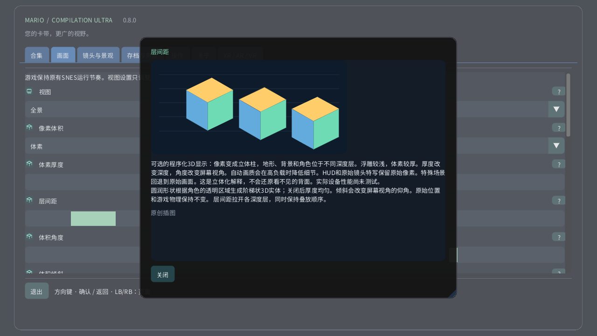

# 像素体积

[English](../en/VOXELS.md) · [Français](../fr/VOXELS.md) · [Español](../es/VOXELS.md) · [日本語](../ja/VOXELS.md) · [Deutsch](../de/VOXELS.md) · [Italiano](../it/VOXELS.md) · [Português](../pt/VOXELS.md) · [Русский](../ru/VOXELS.md) · [简体中文](../zh/VOXELS.md) · [한국어](../ko/VOXELS.md)

在电脑或触屏设备上打开画面 → 像素体积。先试试深度较浅的像素浮雕，再切换到体素。厚度改变每个像素的实体厚度，间距拉开各层而不改变叠放顺序。在Quest上使用空间遥控器的立体页面。手表表冠仍可从完整区域缩放到原始画面。

可选的程序化3D显示：像素变成立体柱，地形、背景和角色位于不同深度层。浮雕较浅，体素较厚。厚度改变深度，角度改变屏幕视角。自动画质会在高负载时降低细节。HUD和原始镜头特写保留原始像素。特殊场景回退到原始画面。这是立体化解释，不会还原看不见的背面。实际设备性能尚未测试。 圆润形状根据角色的透明区域生成阶梯状3D实体；关闭后厚度均匀。倾斜会改变屏幕视角的仰角。原始位置和游戏物理保持不变。 层间距拉开各深度层，同时保持叠放顺序。

| 像素体积 | |
|---|---|
| 0 | 原始2D |
| 1 | 像素浮雕 |
| 2 | 体素 |

- **体素厚度**: 1–16 px
- **层间距**: 1–12 px
- **体积角度**: −30° … +30°
- **体积倾斜**: −30° … +30°
- **圆润体素形状**

[合集](README.md) · [图解设置](SETTINGS.md) · [HTML](voxels.html) · [Technical research](../VOXEL_RESEARCH.md)
