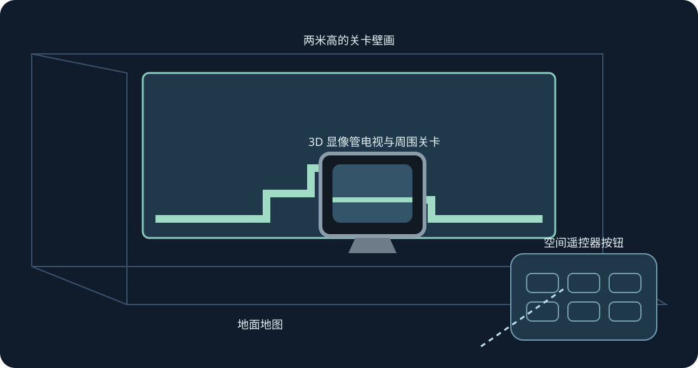

# Mario Compilation Ultra 0.5.0 · Quest VR / AR

[English](../en/XR.md) · [Français](../fr/XR.md) · [Español](../es/XR.md) · [日本語](../ja/XR.md) · [Deutsch](../de/XR.md) · [Italiano](../it/XR.md) · [Português](../pt/XR.md) · [Русский](../ru/XR.md) · [简体中文](../zh/XR.md) · [한국어](../ko/XR.md)

关卡墙面、地面、街机桌、CRT 和曲面画廊。实验性 XR 预览，可用双侧抓握缩放。

实验性 XR 预览。用户已确认安装后 Quest 3 能显示 0.4 收藏界面，并记录了帧提交。0.5 构建另行编译检查。跟踪、舒适度、透视、房间放置及持续游玩仍需实体设备测试。

稍后测试时，启用开发者模式并通过 SideQuest 或 adb install -r 安装公开 ARM64 APK。在未知来源中打开 Mario Compilation Ultra XR，用系统选择器导入卡带或 ZIP 后开始游戏。All-Stars + World 和 Yoshi’s Island 须分别导入。公开 APK 不含 ROM 或进度。

空间屏幕 | 适应已扫描墙面 | 两米高的关卡壁画 | 地面地图 | 街机游戏桌 | 3D 显像管电视与周围关卡 | 曲面关卡画廊

将关卡、原生 CRT、遥控器或选项设为目标。单手握持可移动旋转，双手可在位置锁定时缩放关卡。遥控器还提供微调、减半、加倍和重置。恢复按钮将界面带回附近。Y 打开选项，游玩页面包含所有 SNES 按钮。

捏合并拖动摇杆，用另一只手操作按钮。中指捏合抓取把手。跟踪丢失时会松开输入。

新安装默认请求 90 Hz 和两米高的透明 AR 壁画。不支持时回退到可用刷新率，游戏模拟保持原速。自动墙面可选用场景、锚点权限及房间扫描；也支持手动放置和地面校准。透视由运行时提供，应用不请求网络、麦克风或摄像头画面权限。

半透明预览仅提供信息，不模拟远处物体。已验证位置可在开始时显示，已学习图像只来自本地游戏。

街机桌显示已加载区域。保留原作物理和物体激活规则。

电脑快捷控制：按住右摇杆，方向键左右缩放，上为 1:1，下为全图，A 固定，B 原镜头，X 截图，Y 跟随玩家。松开后恢复 SNES 操作。F1 或菜单 Y 帮助打开图解。

SNES: D-pad · A · B · X · Y · L · R · Start · Select

Touch: A → SNES B · B → SNES Y · X → SNES A · RT → SNES X · R3 → Start · LT → Rewind · Y → 移动选项

[HTML](xr.html) · [Guide](README.md) · [Build](../BUILD.md) · [Parity](../PARITY.md) · [Validation](../TEST_REPORT.md)

[Meta developer mode](https://developers.meta.com/vr/documentation/android-apps/enable-developer-mode/) · [Meta refresh API](https://developers.meta.com/vr/documentation/native/android/mobile-display-refresh-rate/) · [Meta passthrough](https://developers.meta.com/vr/documentation/native/android/mobile-passthrough/)
